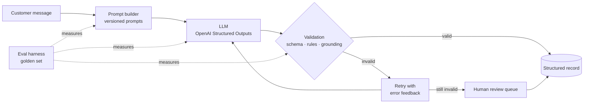

# E-commerce Support Triage

> An LLM pipeline that turns messy customer support messages into validated, structured data - and an eval harness that proves, with numbers, how reliable it is.

🚧 **Status: in development.** See the [roadmap](#roadmap) for what is done and what is next.

## The problem

Online stores receive thousands of free-text messages a day: *"comprei um fone dia 10, pedido #48213, chegou quebrado e quero meu dinheiro de volta URGENTE"*. Before anyone can act on them, someone has to read each one and decide what it is about, how urgent it is, and which order it refers to.

Companies rarely need another chatbot for this. They need that messy text converted into **clean records a normal system can store, route and report on** - reliably, at scale, with a clear answer to *"what happens when the model gets it wrong?"*.

## What this project does

Given one customer message (in Brazilian Portuguese), the pipeline returns a validated JSON record:

```json
{
  "category": "damaged_or_defective",
  "requested_action": "refund",
  "priority": "high",
  "priority_reason": "Produto chegou quebrado e cliente pede reembolso com urgência.",
  "sentiment": "angry",
  "summary": "Cliente recebeu fone quebrado no pedido 48213 e pede reembolso.",
  "order_ids": ["48213"],
  "products": ["fone"],
  "amounts_brl": []
}
```

The interesting part is not the LLM call - it is everything around it:

- **Strict output contract** - one Pydantic schema is both the JSON schema sent to the model and the validator applied to its answer.
- **Layered validation** - schema, business rules, and *grounding* (an order number the model returns must actually appear in the message).
- **Resilience** - invalid outputs trigger a retry that tells the model exactly what to fix; items that still fail go to a human review queue instead of silently entering the database.
- **Measurement over guesswork** - an eval harness runs a labelled golden set against different prompts, models and pipeline configurations, and reports accuracy, latency, cost and regressions.

## Planned architecture



## Roadmap

Each phase ends in a usable, documented state. Progress is tracked in [GitHub issues and milestones](../../milestones).

- [ ] **Phase 1 - Core:** data schema, OpenAI client, versioned prompts, pipeline, CLI, architecture docs
- [ ] **Phase 2 - Eval harness:** golden set, runner comparing configurations, metrics (accuracy, p95 latency, cost), comparative report, documented v1 baseline
- [ ] **Phase 3 - Resilience:** business-rule validation, grounding check, retry with error feedback, human review queue - each change measured against the baseline
- [ ] **Phase 4 - Product:** FastAPI service, SQLite persistence, review UI, Docker, CI

## Tech stack

Python 3.11+ · Pydantic v2 · OpenAI API · FastAPI · pytest · Ruff
