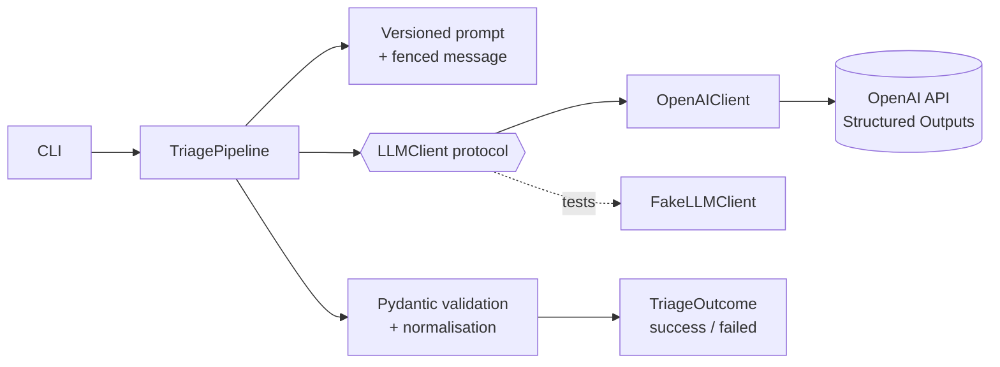

# E-commerce Support Triage

[](https://github.com/augustoqas/data-screening-and-structuring/actions/workflows/ci.yml)


> An LLM pipeline that turns messy customer support messages into validated, structured data, and an eval harness that proves, with numbers, how reliable it is.

**Status:** Phase 1 (core pipeline) complete. Phase 2 (eval harness) is next. See the [roadmap](#roadmap).

## The problem

Online stores receive thousands of free-text messages a day: *"oi, fui cobrado duas vezes no cartão pelo pedido 77120 (R$ 349,90 cada) e ainda por cima a entrega ta atrasada uma semana"*. Before anyone can act on them, someone has to read each one and decide what it is about, how urgent it is, and which order it refers to.

Companies rarely need another chatbot for this. They need that messy text converted into **clean records a normal system can store, route and report on**: reliably, at scale, with a clear answer to *"what happens when the model gets it wrong?"*.

## What it does

The message above, run through the pipeline (real output, `gpt-5.4-mini`):

```json
{
  "status": "success",
  "result": {
    "category": "payment_issue",
    "requested_action": "refund",
    "priority": "urgent",
    "priority_reason": "Há cobrança duplicada no cartão, o que indica perda financeira em andamento.",
    "sentiment": "frustrated",
    "summary": "O cliente relata cobrança em duplicidade no cartão para o pedido 77120, com dois lançamentos de R$ 349,90 cada. Também informa que a entrega está atrasada há uma semana.",
    "order_ids": ["77120"],
    "products": [],
    "amounts_brl": [349.9, 349.9]
  },
  "error": null,
  "model": "gpt-5.4-mini-2026-03-17",
  "prompt_version": "v1",
  "input_tokens": 982,
  "output_tokens": 114,
  "latency_ms": 2693.46
}
```

Two problems were mentioned; the pipeline picked the one losing money right now (the duplicate charge) and kept the other in the summary. `"R$ 349,90"` became the number `349.9`. Every outcome records the exact model version, prompt version, tokens and latency.

What every value means is defined in the [taxonomy](docs/taxonomy.md).

## Design highlights

The LLM call is the easy part. The project is about everything around it:

- **One contract, used twice.** A single Pydantic model is sent to the LLM as a strict JSON schema *and* validates the answer, so what we ask for and what we accept cannot drift apart. ([ADR 0001](docs/adr/0001-single-schema-for-prompt-and-validation.md))
- **Normalisation and rejection.** Validators turn `" #48213 "` into `"48213"` and reject well-formed but unusable outputs: empty summaries, negative amounts, invented fields.
- **Failures are data.** A bad model answer becomes a `failed` outcome with the raw output, tokens and latency, never a crash in the middle of a batch. ([ADR 0004](docs/adr/0004-failures-as-outcomes.md))
- **Provider-independent and testable.** The pipeline depends on a small `LLMClient` protocol; tests use a fake client to reproduce every failure offline. ([ADR 0002](docs/adr/0002-llm-client-protocol.md))
- **Versioned prompts.** Prompts are immutable files (`v1.md`, `v2.md`...), so changes can be measured instead of guessed. ([ADR 0003](docs/adr/0003-versioned-prompt-files.md))
- **Prompt-injection hardening.** Customer text is fenced as data and cannot close the fence early.

## Architecture



Components, request flow, error handling, security and testing strategy are described in [docs/architecture.md](docs/architecture.md).

## Getting started

**Requirements:** Python 3.11+ and an [OpenAI API key](https://platform.openai.com/api-keys).

```bash
git clone https://github.com/augustoqas/data-screening-and-structuring.git
cd data-screening-and-structuring

python -m venv .venv
source .venv/bin/activate        # Windows: .venv\Scripts\activate
pip install -e ".[dev]"

cp .env.example .env             # Windows: copy .env.example .env
# then open .env and set OPENAI_API_KEY
```

`.env` is git-ignored. Setting a low monthly spending limit on your OpenAI project is recommended; one message costs roughly a tenth of a US cent with the default model.

## Usage

```bash
triage "comprei um fone, pedido #48213, chegou quebrado"   # message as argument
triage --file mensagem.txt                                  # from a UTF-8 file
echo "cadê meu pedido??" | triage                           # from stdin
triage "..." --model gpt-5.4-nano --prompt-version v1       # override settings
```

The full outcome is printed as JSON.

| Exit code | Meaning |
|---|---|
| `0` | Success |
| `1` | The pipeline returned a `failed` outcome (see `error` and `raw_output`) |
| `2` | Usage or configuration error (missing key, invalid setting, missing file...) |

From Python:

```python
from triage import TriagePipeline
from triage.config import get_settings
from triage.llm import OpenAIClient

settings = get_settings()  # reads .env and environment variables
client = OpenAIClient(settings.model, api_key=settings.openai_api_key.get_secret_value())
pipeline = TriagePipeline(client, prompt_version=settings.prompt_version)

outcome = pipeline.run("pedi tênis 42 e veio 38")
if outcome.status == "success":
    print(outcome.result.category)  # wrong_item
```

## Configuration

Set in `.env` or as environment variables. Invalid values are rejected at startup with a clear message.

| Variable | Default | Description |
|---|---|---|
| `OPENAI_API_KEY` | (required) | OpenAI API key |
| `TRIAGE_MODEL` | `gpt-5.4-mini` | Model used for triage |
| `TRIAGE_PROMPT_VERSION` | `v1` | Prompt file under `src/triage/prompts/` |
| `TRIAGE_REQUEST_TIMEOUT_S` | `30` | Timeout per API request, in seconds |
| `TRIAGE_TEMPERATURE` | unset | Only for models that accept it; reasoning models reject it |
| `TRIAGE_REASONING_EFFORT` | unset | `minimal`, `low`, `medium` or `high` (reasoning models only) |

## Development

```bash
pytest                    # unit tests: offline, no API key needed
ruff check .              # lint
ruff format .             # format
```

CI runs lint and tests on Python 3.11, 3.12 and 3.13 for every pull request; `main` only accepts merges through pull requests with passing checks.

Unit tests check the code. Whether the *model* classifies messages correctly is a different question, answered by the eval harness in phase 2.

## Project structure

```text
├── src/triage/
│   ├── schemas.py         # Data contract: enums, TriageResult, TriageOutcome, strict JSON schema
│   ├── prompts/
│   │   ├── __init__.py    # Prompt loading and injection-safe message building
│   │   └── v1.md          # System prompt, version 1
│   ├── llm.py             # LLMClient protocol and OpenAI implementation
│   ├── pipeline.py        # TriagePipeline: prompt -> LLM -> validation -> outcome
│   ├── config.py          # Settings from environment / .env
│   └── cli.py             # `triage` command
├── tests/                 # pytest suite (fake LLM client, no network)
├── docs/
│   ├── architecture.md    # Components, flow, error handling, security, testing
│   ├── taxonomy.md        # Meaning of every category, priority and field
│   └── adr/               # Architecture decision records
├── .github/workflows/     # CI
├── .env.example           # Configuration template
└── pyproject.toml
```

## Roadmap

Each phase ends in a usable, documented state. Work is tracked in [issues and milestones](https://github.com/augustoqas/data-screening-and-structuring/milestones).

- [x] **Phase 1 - Core:** data schema, OpenAI client, versioned prompts, pipeline, CLI, CI, architecture docs
- [ ] **Phase 2 - Eval harness:** golden set, runner comparing configurations, metrics (accuracy, p95 latency, cost per correct answer), comparative report, documented v1 baseline
- [ ] **Phase 3 - Resilience:** business-rule validation, grounding check, retry with error feedback, human review queue, each change measured against the baseline
- [ ] **Phase 4 - Product:** FastAPI service, SQLite persistence, review UI, Docker

### Known limitations

- **Priority can follow the customer's tone instead of the rules.** In manual tests, *"chegou quebrado... URGENTE"* was rated `urgent` although the rules say a damaged item is `high`. The JSON was valid, so no unit test can catch this; measuring it is the job of the eval harness (phase 2), and phase 3 adds business-rule checks.

## Tech stack

Python · Pydantic v2 · pydantic-settings · OpenAI API (Structured Outputs) · pytest · Ruff · GitHub Actions
