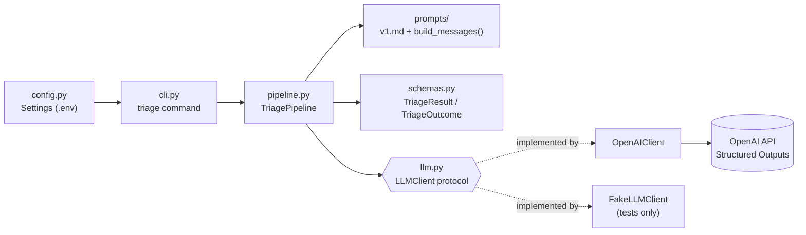
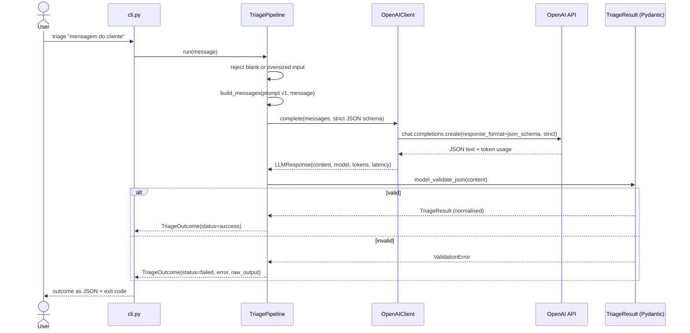
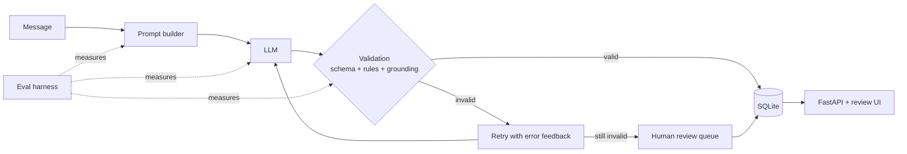

# Architecture

This document explains how the triage pipeline is built and why. For the meaning of each output value see the [taxonomy](taxonomy.md); for the reasoning behind individual decisions see the [architecture decision records](adr/README.md).

## Goals

1. **Turn free text into data a normal system can use.** The output is a fixed set of fields with controlled values, not prose.
2. **Never let a bad answer through silently.** Every model output is validated; anything that fails is reported as a failure with enough context to debug it.
3. **Make quality measurable.** Prompts and models are versioned and every outcome records what produced it, so changes can be evaluated instead of guessed (phase 2).
4. **Keep the LLM replaceable.** The pipeline depends on a small interface, so tests run offline and the provider can change.

## Components

| Module | Responsibility | Depends on |
|---|---|---|
| [`schemas.py`](../src/triage/schemas.py) | The data contract: enums, `TriageResult` with validators, `TriageOutcome`, and conversion to an OpenAI strict JSON schema | Pydantic |
| [`prompts/`](../src/triage/prompts/__init__.py) | Versioned system prompts and injection-safe construction of the chat messages | Nothing |
| [`llm.py`](../src/triage/llm.py) | `LLMClient` protocol, `LLMResponse`, `LLMError`, and the OpenAI implementation | OpenAI SDK (the only module that imports it) |
| [`pipeline.py`](../src/triage/pipeline.py) | Orchestration: guard input, build prompt, call the client, validate, return an outcome | schemas, prompts, the `LLMClient` protocol |
| [`config.py`](../src/triage/config.py) | Settings from environment variables and `.env`, validated at startup | pydantic-settings |
| [`cli.py`](../src/triage/cli.py) | Command-line entry point; the only place that wires settings, client and pipeline together | everything above |

Dependencies point one way: `cli` knows about everything, `pipeline` knows the protocol but not OpenAI, and `schemas` and `prompts` know about nothing else in the project.

## Request flow

## The data contract

`TriageResult` is defined once and used twice:

1. **As instructions.** It is converted into a JSON schema and sent to the model with Structured Outputs in strict mode, so the API constrains generation to that shape. Field descriptions travel inside the schema and act as per-field instructions (for example, the priority rules live in the `priority` description).
2. **As a validator.** The model's answer is parsed with the same model. Validators normalise harmless variation (`" #48213 "` becomes `"48213"`) and reject outputs that are well-formed but unusable (an empty summary, a negative amount, an unknown key).

Every field is required. "Nothing found" is expressed explicitly (an empty list, `none`, `out_of_scope`), so a missing key always means the model failed.

Strict mode accepts only part of JSON Schema, so `to_openai_json_schema()` closes every object, marks every property as required, inlines `$ref`s and drops defaults. A test walks the whole generated schema to enforce this. See [ADR 0001](adr/0001-single-schema-for-prompt-and-validation.md).

## Error handling

| Situation | Where it is detected | Result |
|---|---|---|
| Blank or oversized message (over 5,000 characters) | `TriagePipeline.run` | `ValueError`: a caller bug, not a runtime condition |
| Unknown prompt version | `load_prompt` | `FileNotFoundError` at pipeline creation |
| Network error, timeout, rate limit, 5xx | OpenAI SDK, then `OpenAIClient` | SDK retries transient errors (2 retries, exponential backoff); if they persist, `LLMError` becomes a `failed` outcome |
| Model refusal or truncated output | `OpenAIClient` | `LLMError`, then a `failed` outcome |
| Invalid JSON, schema violation, validator rejection | `TriageResult` validation | `failed` outcome with a one-line, field-specific error and the raw output |
| Missing or invalid configuration | `Settings`, `OpenAIClient`, `cli` | One-line error message, exit code 2 |

Runtime problems caused by the model or provider never raise: in a batch of thousands of messages, one bad answer must not stop the rest. Failed outcomes still record tokens and latency, because a failed call still costs money and time. See [ADR 0004](adr/0004-failures-as-outcomes.md).

The validation error format (`priority: Input should be 'low', 'medium', 'high' or 'urgent'`) is deliberately short: in phase 3 it is sent back to the model on retry, telling it exactly what to fix.

## Security

- **Secrets.** The API key is read from the environment or a git-ignored `.env` file and stored as a `SecretStr`, so it is masked if settings are printed or logged. This protects against accidental exposure in logs only: the key is still in process memory, as it must be to call the API. GitHub secret scanning with push protection is enabled on the repository.
- **Prompt injection.** Customer text is sent inside `<customer_message>` tags, and the system prompt says everything inside them is data. Any closing tag inside the customer text is stripped first, so a message cannot close the data block early and append text that looks like instructions. This is one layer of defence, not a guarantee; the golden set (phase 2) includes injection attempts to measure real behaviour.
- **Least privilege in CI.** The workflow token can only read the repository, and tests need no secrets.

## Testing strategy

| Technique | Used for | Why |
|---|---|---|
| **Fake client** (`FakeLLMClient`) | Pipeline and CLI tests | Implements the `LLMClient` protocol with scripted outputs or errors. Every failure path runs deterministically, offline and for free. |
| **SDK stub** | `OpenAIClient` tests | Replaces only the SDK call and returns real `ChatCompletion` objects, checking both the request we send and how we read the response. |
| **Plain unit tests** | Schemas, prompts, settings | Pure functions and models, no doubles needed. |

CI runs `ruff` and `pytest` on Python 3.11, 3.12 and 3.13 for every pull request, and `main` only accepts merges with passing checks.

Unit tests check that the **code** is correct. They cannot tell whether the **model** classifies messages well; that is the job of the eval harness in phase 2, which runs a labelled golden set against the real API.

## Where this is going

| Phase | Adds |
|---|---|
| 1 - Core (this document) | Schema, client, prompts, pipeline, CLI, CI |
| 2 - Eval harness | Golden set, runner comparing configurations, accuracy / latency / cost metrics, comparative report |
| 3 - Resilience | Business rules, grounding of extracted entities, retry with error feedback, human review queue |
| 4 - Product | FastAPI service, SQLite persistence, review UI, Docker |
